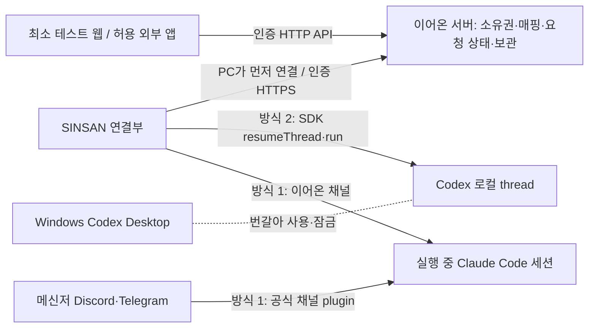
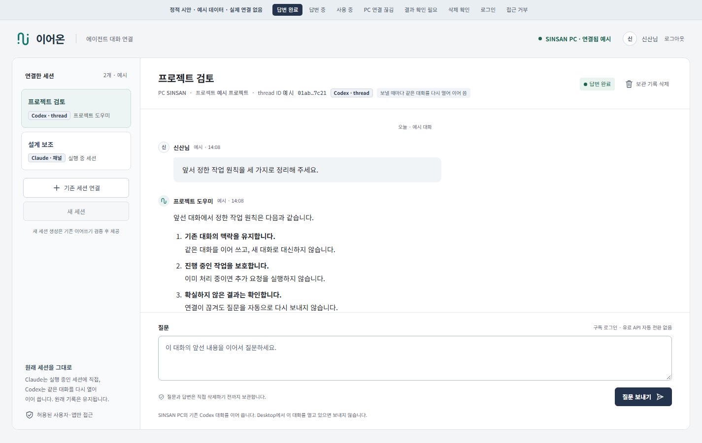
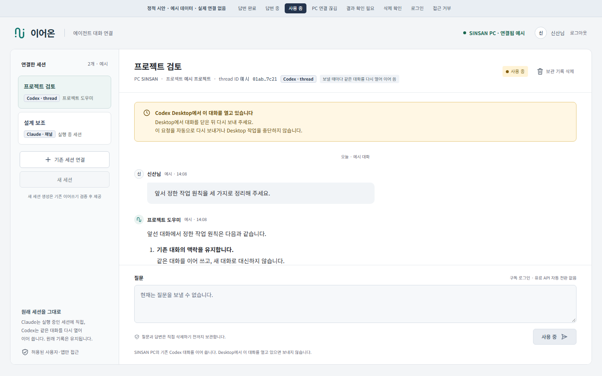
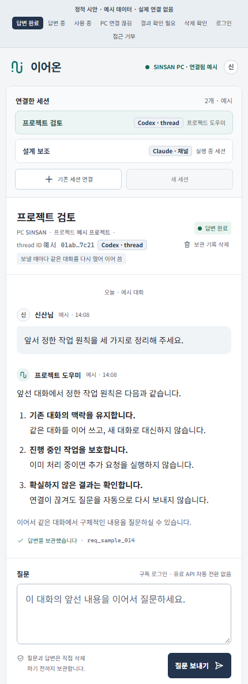

# 이어온 — 기존 에이전트 세션 연결 설계서

- 버전: **0.3 / 2026-11-08** (0.2 / 2026-10-29 본문은 아래 1절부터 그대로 유지) / 작성: 어울
- 상태: 첫 실증 완료 후 기능이 넓어졌다. 현재 구조는 바로 아래 0절, 기능별 세부 설계는 각 문서. 실제 기동·로그인·모델 호출·서버 쓰기·배포는 단계별 별도 승인.

## 0. 현재 구조 요약 (v0.3, 2026-11-08)

**제품은 저장소 하나, 설치 형태 둘**이다(결정 2026-11-06, 이름 표기 "ieon=PC 완결형, ieun=허브형").

| 설치 형태 | 이름·호스트 | 어디에 무엇이 있나 |
| --- | --- | --- |
| PC 완결형 | **ieon-gateway** · `ieon-gateway.sinsan.kr` | PC에 서버·연결부·메신저·웹. 공개 서버(sinsan-server)에는 카카오·Teams 수신 **중계(`ieon-relay`)만** |
| 허브형 | **ieun-gateway** · `ieun-gateway.sinsan.kr` | 허브(sinsan-server)에 서버·메신저·웹·중계, PC에는 **연결부만**(허브에 HTTPS로 접속) |

| 기능 | 내용 | 세부 설계 | 상태 |
| --- | --- | --- | --- |
| 기존 세션 연결 | Claude Code 채널(방식 1), Codex thread 재개(방식 2: 번갈아 쓰기·동시 사용) | 이 문서 1~13절 | 첫 실증 완료 |
| 새 세션 만들기 | 이어온이 새 Codex·Claude 세션과 작업 폴더를 만들고 정리(잠들기·보관·삭제) | [NEW_SESSIONS](NEW_SESSIONS.md), Oracle [N6_ORACLE_PLAN](N6_ORACLE_PLAN.md) | N0~N6 완료 |
| 여러 봇 | 같은 메신저의 여러 봇, 웹 봇 관리, 역할(엔진·권한 제한·AI 안내), 부른 봇만 답 | [MULTI_BOTS](MULTI_BOTS.md) | M0~M3 완료, M4·M6(카카오) 실측, M5(Teams) 보류 |
| 공개 수신 중계 | 카카오·Teams가 보내는 메시지를 Oracle 중계가 받고 PC가 먼저 접속해 가져감 | [RELAY_DEPLOY](RELAY_DEPLOY.md) | sinsan-server 배포·카카오 실측 |
| 설치 형태 분리 | PC 완결형·허브형, 설정의 DB·웹 이전, 허브 접속 제한(IP·Cloudflare Access·Tailscale 선택), 기기 토큰 화면 | [HUB_AND_PC_PROFILES](HUB_AND_PC_PROFILES.md) | P0 완료, **다음 P1** |

**변하지 않는 원칙**: 기존 세션은 복사·fork·새 대화로 대체하지 않는다. 업무 대화 `01a0dadd-…`는 대상이 아니다. 자동 재전송·잠금 강제 해제가 없다. 토큰은 웹이 받지 않고 `.env`·비밀 파일에만 둔다. 연결부의 안전 설정(허용 목록·`live`·작업 폴더·`full`)은 기기 로컬에만 둔다.

**실행 환경**: PC(Windows) `pwsh scripts/ieon.ps1`, Linux·WSL·Oracle `scripts/ieon.sh`+systemd 사용자 유닛. 포트 28760(서버)·28761(Codex 공유 App Server)·28762(Claude 채널), 모두 127.0.0.1. 저장소 `cyhuh7950/ieon-gateway`(0.0.1~).

---


- 요구 근거: 신산님의 채팅 지시와 [WORK_STATUS](../WORK_STATUS.md)의 인터뷰·결정 기록.
- 실행 계획: [작업계획](../WORK_PLAN.md) / 실제 환경: [개발환경](../DEVELOPMENT_ENVIRONMENT.md)

**v0.2 핵심 변경:** 연결 대상을 엔진별로 나눈다. **Claude Code는 공식 Channels로 실행 중인 세션에 메시지를 넣고(방식 1), Codex는 연결부가 대화방↔thread ID 매핑을 저장하고 질문마다 공식 SDK `resumeThread`로 같은 thread를 재개한다(방식 2).** v0.1의 "실행 중인 Codex Desktop runtime에 직접 붙는 구조"는 공개 접속 계약이 확인되지 않아 채택하지 않는다. 이전 경로 검토(Remote Control 보류, 관리 App Server 대안, 클라우드 계정 조회)는 [13절 이력](#13-승인-경계와-변경-이력)과 각 검증 문서에 보존한다.

## 1. 목적과 판정 기준

외부 프로그램(최소 테스트 웹, 이후 메신저)에서 **새 모델 대화가 아니라 사용자가 지정한 기존 작업 세션**과 대화한다. 대상은 **Codex(Desktop/CLI)와 Claude Code의 작업 세션**이며, ChatGPT·Claude 웹/앱의 일반 채팅방은 대상이 아니다. 이 문서의 "대화방"은 질문을 보내는 외부 메신저 쪽 방을 뜻하고, "세션"·"thread"는 작업 세션을 뜻한다. 그 세션의 앞선 맥락으로 답하고, 외부에서 나눈 내용이 같은 세션 기록에 남아야 한다. 기록 복사·fork·새 대화는 성공으로 인정하지 않는다.

| 엔진 | 성공 기준 |
| --- | --- |
| Claude Code (방식 1) | 실행 중인 같은 세션이 외부 메시지를 받아 그 맥락으로 답하고, 답이 같은 외부 대화방으로 돌아온다. 세션 터미널에도 수신 기록이 남는다 |
| Codex (방식 2) | 같은 thread ID를 재개해 앞선 맥락으로 답하고, 이후 Desktop에서 그 thread를 다시 열면 외부 turn이 보인다. Desktop이 사용 중이면 실행하지 않고 "사용 중"으로 거부한다 |

**Codex 첫 실증 순서: Desktop → 이어온 → Desktop.** Claude 첫 실증은 공식 fakechat 데모 채널로 왕복을 확인한 뒤 실제 메신저로 넓힌다.

## 2. 확정 범위와 후속 범위

| 구분 | 범위 |
| --- | --- |
| 첫 이용자·PC | 신산님 한 명 / SINSAN 한 대 |
| 대상 엔진 | Claude Code 세션(방식 1), Windows Codex 로컬 thread(방식 2). 클라우드 Codex task는 공개 이어쓰기 수단이 없어 제외 |
| 첫 호출 앱 | 최소 테스트 웹. 대화 선택·질문·상태·답변. Claude는 공식 채널 plugin(fakechat→Discord/Telegram) 경로도 사용 |
| 첫 지식·도구 | 기존 세션 맥락만. 새 문서·RAG·MCP 추가 없음(Channels용 공식 plugin 제외) |
| 동시 사용 | Claude: 세션 하나에 메시지가 차례로 들어감. Codex: Desktop과 번갈아 사용, Desktop이 thread를 열고 있으면 거부 |
| 인증 | 각 엔진의 기존 공식 로그인. API 키 경로는 별도 검증 |
| 보관 | 질문·답변은 사용자 삭제 전까지. 원래 세션 기록은 각 PC에 유지 |
| 후속 | 새 세션 생성, API 키 전환, 지식/MCP 관리, 다른 앱, Oracle 배치, `codex queue` 단독 접수 경로(Codex 공유 App Server 모드 자체는 3절 설정 선택으로 범위에 포함) |
| 제외 | 다중 사용자 가입·관리 화면, 범용 Provider 프레임워크, GPU/로컬 LLM, 임의 코드 실행·권한 확대 |

## 3. 엔진별 연결 방식

| 항목 | 방식 1 — Claude Code Channels | 방식 2 — Codex thread 매핑·재개 |
| --- | --- | --- |
| 원리 | 채널(MCP 서버)이 실행 중인 세션에 이벤트를 push, 세션이 채널의 `reply` 도구로 응답 | 연결부가 질문마다 `codex.resumeThread(threadId)` → `run(질문)` → 결과 수집 → thread 반납 |
| 세션 상태 | 세션이 계속 열려 있어야 수신. 상시 사용은 백그라운드/지속 터미널 | 질문 사이에는 thread를 쥐지 않음. Desktop과 번갈아 사용 |
| 식별 | 세션 = `--channels`로 띄운 Claude Code 프로세스 | 대화방 ↔ 서버가 검증한 thread ID 매핑 |
| 사용 중 처리 | 세션이 처리 중이면 메시지가 차례를 기다림. 권한 확인에서 멈출 수 있음 | Desktop이 thread를 열고 있으면 OS writer 잠금 충돌(실측 ERROR_LOCK_VIOLATION 33) → busy 거부, 재시도 없음 |
| 공식 근거 | Channels 연구 미리보기, Telegram·Discord·iMessage·fakechat plugin | Codex SDK TypeScript `resumeThread`, CLI `codex exec resume` |
| 실증 상태 | 미실행 | **조건부 PASS(2026-10-30)**: 같은 thread로 D→I→D 맥락 확인. 단 Desktop은 앱 종료 시에만 잠금 반납, 반영은 재실행 후 확인 |

선택 이유: 각 엔진이 공개한 공식 기능만 사용한다. Desktop 내부 protocol 모방·인증 재사용·GUI 조작·기록 복사로 우회하지 않는다.

**Codex 확장 후보 — 공유 App Server에 열린 세션(채택 아님, 2026-10-29 공식 문서 확인):** Codex에도 Channels와 비슷한 "열린 세션에 외부 메시지 넣기"가 있다. 이전의 "Codex는 MCP pull만 가능"이라는 설명은 틀렸으므로 정정한다.

- Python SDK `ExternalMessage`: 대기 중 thread에서는 새 turn을 시작하고, 실행 중인 일반 turn에는 합류해 결과를 받는다. 내용은 사용자 승인이 아닌 tool 수준의 비신뢰 입력이다. Codex CLI 0.151.0 이상.
- `codex queue --thread <ID> --message ...`: 기존 세션에 텍스트를 접수한다. `--remote`로 App Server endpoint를 지정한다. 문서에는 최종 답변 반환이 없어 응답 수집 연결부가 따로 필요하다.
- 사람 화면: `codex app-server --listen ws://…`로 띄운 공유 서버에 TUI가 `--remote`로 붙는다.

조건은 **이어온과 사람 화면이 같은 App Server에 붙어 있는 것**이다. 이 경우 잠금 반납 없이 열린 세션을 함께 쓸 수 있다. 다만 사람 화면은 Windows Codex Desktop 창이 아니라 공식 CLI/TUI가 되고, 현재 Desktop의 App Server에 외부가 붙는 공식 경로는 여전히 미확인이다. 근거: [Channels·Codex 입력 비교](../validation/CLAUDE_CHANNELS_CODEX_INPUT_REVIEW.md), [SDK API](https://github.com/openai/codex/blob/720fec862a608ae1e5878d1eecb04fb93192e93c/sdk/python/docs/api-reference.md#L309-L356), [codex queue](https://learn.chatgpt.com/docs/developer-commands#codex-queue).

### Codex 연결 모드 — 설정에서 선택 (2026-10-30 신산님 결정)

둘 중 하나만 채택하지 않는다. 두 모드를 모두 구현하고 **Codex 세션별 설정**에서 고른다. 기본값은 실증된 `alternate`다.

| 모드 | 설정 값 | 쓰는 경우 | 사람 화면 | 잠금·사용 중 처리 |
| --- | --- | --- | --- | --- |
| 번갈아 쓰기 (방식 2, 실증 조건부 PASS) | `alternate` | Desktop과 이어온 중 한쪽만 쓸 때, 또는 이어온 전용 계정·전용 thread로 운영할 때 | Windows Codex Desktop(필요할 때만) | 질문마다 `resumeThread` 후 반납. Desktop이 쥐고 있으면 `desktop_holds_thread` busy 거부. Desktop 쪽은 앱 종료 시 반납 |
| 동시 사용 (공유 App Server, 미실증) | `shared_server` | 사람과 이어온이 같은 세션을 앱 종료 없이 함께 써야 할 때 | 공식 TUI(`codex --remote`) | 공유 엔진 하나가 writer. 연결부는 같은 서버에 `ExternalMessage`로 입력. 실행 중 turn 합류 여부는 정책 설정 |

- **모드 전환 조건**: 해당 세션에 진행 중 요청이 없을 때만 바꾼다. `alternate`→`shared_server`는 Desktop이 그 thread를 놓았는지(잠금 사전 확인) 먼저 본다. `shared_server`→`alternate`는 공유 엔진이 thread를 반납했는지 확인한다. 전환은 thread를 복사·fork하지 않는다.
- **`shared_server` 추가 설정**: endpoint는 loopback(`ws://127.0.0.1:포트`)만 허용, 원격 인증 토큰은 환경 변수 참조만 저장(원문 비저장), 실행 중 turn 처리 정책 `reject_busy`(기본) / `join_turn`. 공유 엔진 미기동·단절은 `device_unavailable`(`reason=shared_server_down`), 자동 기동·자동 재시도 없음.
- **`shared_server` 규칙**: 공유 엔진에 붙은 thread는 Desktop에서 열지 않는다(잠금 충돌). 외부 메시지는 비신뢰 입력이므로 도구 승인 권한을 주지 않는다. 엔진 기동·포트 개방은 별도 승인 항목이다.
- **전용 계정 운영**: `alternate`에서 이어온 전용 Codex 계정·전용 thread를 쓰면 Desktop과 잠금이 겹치지 않는다. 로그인은 신산님이 직접 하며 credential을 복사하지 않는다.

## 4. 최소 구성과 신뢰 경계



- **이어온 서버**: 사용자·앱·PC·세션 소유권, 대화방↔세션 매핑, 요청 상태, 질문·답변 보관. ID만 알아서는 실행할 수 없다.
- **SINSAN 연결부**: 원래 PC에서 동작하며 서버로 먼저 연결한다. PC 수신 포트를 열지 않는다. 인증정보·원본 기록·작업 폴더를 서버로 복사하지 않는다.
- **방식 1 경로**: 첫 실증은 공식 plugin(fakechat, 이후 Discord/Telegram)을 그대로 쓴다. 이어온 웹이 같은 세션을 쓰려면 이어온 전용 채널 MCP 서버가 필요하며, 연구 미리보기 동안은 `--dangerously-load-development-channels` 개발 플래그로만 시험할 수 있으므로 별도 승인 후 진행한다.
- **방식 2 경로**: 허용 thread 확인 → 잠금 사전 확인 → `resumeThread` → `run` → 최종 결과·thread ID 대조 → 반납. turn/steer·다른 turn 중단·임의 명령/경로를 외부 API에 노출하지 않는다.
- **첫 실증 환경**: 공개 배포 없이 로컬에서 검증한다. Oracle 배치는 후속 별도 승인이다.

### 엔진별 미검증 경계

| 항목 | 방식 1 | 방식 2 |
| --- | --- | --- |
| 기본 왕복 | 공식 문서 기준 가능, 이 PC 미실행 | 공식 문서 기준 가능, 이 PC 미실행 |
| 원래 화면 반영 | 터미널에 수신 줄·도구 호출 표시, 답 본문은 메신저에만 표시 | 앱 재실행 후 같은 대화에 표시됨(실측). 실행 중 실시간 갱신은 미확인 |
| 잠금 반납 | 해당 없음 | 대화 닫기·10분 대기로는 반납 안 됨, 앱 종료 시 반납(실측) |
| 사용 중 경합 | 세션 내부 차례 처리. 권한 확인 대기 시 멈춤 | Desktop 사용 중 거부는 잠금으로 성립 예상, 이어온 turn 중 Desktop 입력 차단은 미확인 |
| 자동 승인 위험 | 채널 sender allowlist에 든 사람은 권한 확인에 응답 가능 | 원래 thread의 sandbox·승인 설정 유지 여부 확인 필요 |

차단 주체가 확인되지 않은 경합은 UNVERIFIED로 두고, Desktop 입력 가로채기·기존 turn 중단·잠금 강제 해제는 하지 않는다.

## 5. 최소 API 계약안

로컬 실증판(`src/pilot/server.mjs`)이 아래 중 표시한 것을 제공한다(2026-10-30). 브라우저도 외부 앱과 같은 경로를 쓴다.

| API | 의미·응답 |
| --- | --- |
| GET /v1/agents | 허용된 에이전트 목록 |
| GET /v1/conversations | 구현. 허용 세션·엔진·PC 연결(`deviceOnline`)·처리 중(`busy`)·엔진 준비(`engineReady`)·Codex 연결 모드(`connectMode`)·잠금 보유 요청(`heldBy`) |
| POST /v1/conversations | 연결부가 공식 조회로 확인한 후보에 발급한 opaque 참조만 연결. 새 세션은 후속 별도 kind |
| POST /v1/conversations/{id}/requests | 질문·Idempotency-Key. 접수 202와 request_id. 완료 응답으로 혼동하지 않음 |
| GET /v1/requests/{id} | 구현. 상태·최종 답변·안전한 오류·사용량(`usage`, 공유 모드 turn 기준) |
| PUT /v1/conversations/{id}/settings | 구현. Codex 연결 모드 전환(`alternate`/`shared_server`). 잠금이 있으면 409 |
| POST /v1/requests/{id}/review | 구현. `unknown`·`approval_required` 요청을 사람이 원래 세션을 보고 `executed: true/false`로 정리. 답 미저장·재전송 없음·잠금 해제 |
| GET·POST /v1/device/jobs… | 구현. 연결부 전용(device 토큰). 작업 조회 시 `x-ieon-health`로 엔진 상태(값만) 보고 |
| GET /v1/conversations/{id}/messages | 이어온이 보관한 질문·답변. 원본 전체 미러가 아님 |
| DELETE /v1/conversations/{id}/messages | 서버 보관 원문 삭제. 원래 세션 기록은 삭제하지 않음 |
| GET /v1/requests/{id}/events | 선택. 초기에는 polling |

거부 코드: 사용 중 409 `conversation_busy`(Codex는 `busy_reason=desktop_holds_thread` 포함), PC 단절 503 `device_unavailable`, 엔진 꺼짐 503(Claude `session_not_running`, 공유 모드 Codex `shared_server_down` — 연결부 상태 보고로 접수 전 거절), 공유 모드 사람 사용 중 `thread_busy`, 같은 키·다른 payload 409 `idempotency_conflict`, 소유권 불일치 404, 로그인 부재 401.

## 6. 최소 데이터 구조안

| 저장 단위 | 최소 필드·제약 |
| --- | --- |
| 사용자·앱 | user_id, org_id, app_id, 앱 권한 범위 |
| PC | host_id, owner_user_id, 허용 앱, 연결 상태, 마지막 확인. device credential 원문 비저장 |
| 에이전트 | agent_id, 표시 이름·엔진, owner/scope, tool allowlist(첫 검증은 비움) |
| 대화 | conversation_id, owner, 허용 app, host_id, engine, session_ref(Codex: 서버 검증 thread_id / Claude: 채널 세션 식별), Codex connect_mode(`alternate`/`shared_server`)·busy 정책·endpoint 참조, 외부 대화방 매핑, 상태 |
| 요청 | request_id, conversation_id, idempotency_key, payload_hash, 상태, 엔진 receipt(turn_id 또는 채널 전달 ID), 시각, 오류 코드, usage nullable |
| 보관 원문 | request_id, 질문·최종 답변, 접근 범위, 생성/삭제 시각. 운영 로그와 분리 |
| 실행 잠금 | session_key=(host_id, engine, session_ref), holder_request_id, fencing generation |
| 삭제 표식 | conversation_id·generation·중복 방지 식별자 |

기술 제안: Node.js 단일 프로세스(Codex TypeScript SDK와 같은 런타임)와 SQLite 단일 writer. Node 24 내장 SQLite는 release candidate이므로 버전 고정·복구 확인 후 실증용으로만 쓴다. 정식 구성은 실증 후 확정한다.

서버와 PC에 요청 receipt를 내구 저장하고, 실행 전 request_id를 저장해 중복 전달을 거부한다. 전송 뒤 ack를 잃으면 unknown을 유지하며 다시 실행하지 않는다.

## 7. 요청 상태·복구·중복 방지

| 상태 | 뜻·다음 조치 |
| --- | --- |
| queued | 접수·저장, 실행 전. 같은 세션 추가 실행 차단 |
| running | 실행 증거 확인(Codex turn 시작 / Claude 채널 전달 확인) |
| approval_required | 권한 확인 대기. 자동 승인 없음 |
| completed | 최종 답변 확인·저장 |
| failed | 명확한 거부·실패. 안전한 오류 코드만 기록 |
| cancelled | 실행 전 취소 또는 실제 취소 확인 시만 |
| unknown | 전송/실행/결과 불명. 자동 재전송·새 세션·다른 인증 재실행 없음. 세션 잠금 유지, 사람 확인(`review`)으로만 정리 |

공유 모드에서 이어온 turn 중 사람이 TUI에서 Enter로 입력하면 같은 turn에 합류(steer)해 답이 바뀐다(실측). 연결부는 turn 안 사용자 메시지가 2개 이상이면 `unknown`(`turn_joined_by_other_input`)으로 보고하고 답을 저장하지 않는다. 사람은 이어온 처리 중 TUI에서 Tab(대기열)으로 입력한다.

브라우저 단절은 취소가 아니다. 연결부 재시작 때 running·전송 중 요청은 receipt와 공식 조회로 대조하고, 완료를 증명하지 못하면 unknown으로 격리한다. 초기 병렬도는 PC당 1개·세션당 1개다. Codex 잠금 충돌은 실패 재시도 대상이 아니라 busy다.

## 8. 인증·권한·비용

### 서비스 호출 인증

소유자 한 명의 최소 로그인/접속 credential을 서버에서 검증하고 허용 앱으로 principal을 만든다. body·임의 header의 user_id를 신뢰하지 않는다. 브라우저에 모델 키를 넣지 않는다. 인증 값·역할 생성은 구현/보안 설정 승인 후 진행한다.

### 엔진 인증

- **Claude Code**: Channels는 claude.ai 로그인 또는 Console API 키가 필요하다. 개인 Pro/Max는 조직 설정 없이 세션별 `--channels` opt-in, Team/Enterprise는 관리자가 `channelsEnabled`를 켜야 한다. 채널 bot token은 plugin 설정 파일에 두며 응답·로그·Git에 넣지 않는다.
- **Codex**: 기존 공식 로그인 상태를 그 PC에서 사용한다. 토큰·auth.json을 복사하거나 서버로 보내지 않는다. 같은 계정 신규 로그인은 사용자가 직접 수행한다.
- **전환 금지**: 구독 한도·인증 실패를 이유로 유료 API로 자동 전환하지 않는다. Desktop 공유 로그인 파일을 덮어쓰거나 logout하지 않는다.

### 권한

- 방식 1: 채널 sender allowlist에 든 사람은 메시지를 넣고, permission relay가 있으면 도구 사용 승인에도 응답할 수 있다. allowlist는 신산님 본인만 둔다. `--dangerously-skip-permissions`는 쓰지 않는다.
- 방식 2: 원래 thread의 model·지시·작업 경로·sandbox 설정을 암묵적으로 바꾸지 않는다. SDK/App Server의 turn override는 후속 기본값에 남을 수 있으므로 일회성으로 취급하지 않는다. 설정 변경이 필요하면 원래 값·revision을 먼저 기록하고 원자적 복원 조건을 확보한 경우만 적용한다.
- 방식 2 실측 보정(2026-10-30): SDK `resumeThread`에 옵션을 넘기지 않으면 원래 thread 설정이 아니라 이 PC `config.toml`(`danger-full-access`)·`approval never`·실행 폴더로 실행됐다. 그래서 이어온 질문은 항상 `read-only`·승인 없음·네트워크/웹 차단·원래 작업 폴더로 고정한다(작업 폴더는 `--cd`가 exec resume에서 실패해 프로세스 시작 시점 폴더로 지정). SDK 옵션은 그 실행에만 적용되고 Desktop은 다음 turn에 자기 설정을 다시 쓴다. 공유 모드 `turn/start`는 override를 넘기지 않아 원래 설정(workspace-write·on-request)으로 실행된다.

### 한도 제안 — 실제 호출 승인 아님

- Codex: 시험용 로컬 thread·현재 허용 모델·사용자 turn 총 3회(Desktop/이어온/Desktop). 업무 대화 01a0dadd-739f-74d2-93c5-9c405cc1019b는 제외.
- Claude: 시험용 세션에서 fakechat 왕복 3회 이내. 도구 실행·파일 변경 없는 단순 대화.
- 질문 8,000자·본문 32 KiB·동시 실행 1개·표시 8,000자·확인 대기 120초를 초기값으로 둔다. 시간 초과는 unknown이다.

## 9. 보관·삭제·로그

질문·답변은 사용자 삭제 전까지 보관한다. 원래 세션 기록은 각 PC에 남기고 서버 삭제와 분리한다. 삭제 후 늦게 온 결과가 원문을 되살리지 못하도록 삭제 generation을 확인한다.

일반 로그 allowlist는 request/trace ID, 내부 대화 참조, 엔진, 상태 전이, 처리 시간, 오류 코드, 확인 가능한 사용량이다. 질문·답변·인증 header·키·토큰·bot token·PC credential은 기본 로그에서 제외한다.

## 10. 첫 실증과 확대 판단

1. 모델 없는 fixture로 소유권·busy·idempotency·재시작·ack 손실·unknown을 두 엔진 공통으로 검증한다.
2. **Codex P0(모델 0):** 시험용 로컬 thread를 Desktop에서 놓은 상태에서 잠금 사전 확인 → 재개 가능 여부 확인. Desktop이 열고 있을 때 거부되는지도 확인.
3. **Codex P1(3 turn):** Desktop에서 맥락 표식 → 이어온 `resumeThread`로 표식 질문 → Desktop에서 다시 열어 반영 확인 후 질문.
4. **Claude C0:** 공식 fakechat 채널로 실행 중 세션 왕복 확인, 세션 미실행 시 거부 확인.
5. **Claude C1:** 이어온 전용 채널(개발 플래그) 또는 공식 Discord/Telegram plugin 중 신산님이 고른 경로로 같은 세션 왕복.
6. **Codex X2(`shared_server`, 미승인):** loopback 공유 엔진 기동 → TUI `--remote`로 시험 thread 열기 → TUI 질문 → 이어온 `ExternalMessage` 질문·답 수집·TUI 실시간 표시 확인 → TUI 질문 → 엔진 종료 후 잠금 반납 확인. 엔진 기동·Python SDK 설치·모델 turn 3회는 별도 승인.
7. 결과표(PASS / FAIL / UNVERIFIED / BLOCKED)를 엔진별로 제시하고 신산님이 나머지 범위를 정한다. 새 세션·API 키·RAG/MCP·Oracle은 자동 착수하지 않는다.

같은 ID라도 반영이 안 되거나, 우회가 필요하거나, busy·권한 차단이 불확실하면 제한/미충족으로 보고한다. 새 세션으로 성공을 대체하지 않는다.

## 11. Oracle 배치안과 실제 환경

실제 확인값은 aarch64·CPU 4개·RAM 23972 MiB·root 여유 26055 MiB(87% 사용), Docker 29.6.1, nginx-proxy-manager의 80/81/443 게시다. 이 값은 조회 snapshot이며 배포 전에 재확인한다.

후속 배치안은 인증 HTTPS API만 기존 proxy 뒤에 두고 프로젝트 전용 service·영속 저장·network를 분리하는 것이다. 두 엔진의 실행은 SINSAN이 담당하므로 Oracle GPU·로컬 LLM은 필요하지 않다. 로컬 서비스 port는 **28760**(공유 App Server 28761, Claude 채널 28762)이다. ieon-agent의 18760~18762와 겹치지 않게 2026-10-31 변경했다. 서버 배포 port는 예약·설정·공개하지 않았다. 배포 경로는 `~/deploy/ieon-gateway`로 변경 지시됐고 실제 서버 경로는 미확인이다. port 확정·Compose·volume·DB·TLS·proxy·방화벽·배포는 별도 승인한다.

## 12. 화면 시안과 디자인 프로필

제품은 업무용 최소 테스트 웹이다. PMO의 기존 화면 표준을 계승하고 신규 마케팅/관리 화면은 만들지 않는다. 정적 시안을 먼저 검토하며 클릭형 시안과 실제 API 연동은 이후 단계다.

**디자인 방향: 원래 세션을 그대로.** 어느 엔진의 어느 세션을 이어 쓰는지와 지금 보낼 수 있는지를 한 화면에서 읽는다. PMO의 차분한 회색 바탕·흰 표면·남색 액션·청록 연결 상태를 계승한다.

- 밀도: compact / 본문·폼 기본 12px, 주요 대화 14px, 제목 20px, 모바일 입력 16px, 기본 line-height 1.6.
- 폰트: Pretendard Variable, Pretendard, Noto Sans KR, Apple SD Gothic Neo, Malgun Gothic, Segoe UI, sans-serif. 외부 CDN 없이 fallback.
- 구조: 상단 사용자·PC 상태 → 세션 목록(엔진 표시) → 현재 세션과 답변 → 질문 입력. 모든 상태를 한국어 문구와 색상으로 함께 표시.
- **엔진 표시(v0.2):** 목록과 현재 세션에 `Claude · 채널`, `Codex · thread` 배지를 붙인다. 연결 방식 설명은 엔진별로 다르게 쓴다. Claude 세션은 "실행 중인 세션에 직접 전달", Codex thread는 "보낼 때마다 같은 대화를 다시 열어 이어 씀".
- **엔진별 사용 중 문구:** Codex는 "Desktop에서 이 대화를 열고 있어 보낼 수 없음 — Desktop에서 대화를 닫은 뒤 다시 시도", Claude는 "세션이 실행 중이 아님 — 세션을 `--channels`로 다시 시작".
- 기본 viewport: 1920×1080 / 1440×900 / 430×844. CSS 전환점은 1600px 이상, 1490px 이하, 900px 이하, 650px 이하.
- 접근성: label·키보드 focus·semantic landmark·상태/오류 구분·4.5:1 본문 대비·200% 확대 목표. 목표 기재는 검증 통과를 뜻하지 않는다.

아래는 `assets/continuity.css`의 현재 토큰 프로필이다. root `DESIGN.md`는 별도로 만들지 않는다. [design.json](../../.impeccable/design.json)은 확장 메타데이터를 기록한다.

```yaml
name: 이어온 정적 시안
description: 기존 Claude Code 세션과 Codex thread를 이어 쓰는 최소 테스트 웹의 디자인 프로필
colors:
  bg: "#f3f5f7"
  surface: "#fff"
  surface-alt: "#f7f9fb"
  text: "#22252b"
  text-muted: "#596472"
  border: "#dfe3e8"
  primary: "#24344d"
  accent: "#0f766e"
  focus: "#2563eb"
  success: "#17654d"
  warning: "#815b0d"
  danger: "#a12b37"
typography:
  body: {fontFamily: '"Pretendard Variable", Pretendard, "Noto Sans KR", "Apple SD Gothic Neo", "Malgun Gothic", "Segoe UI", sans-serif', fontSize: "12px", lineHeight: 1.6}
  conversation: {fontSize: "14px", lineHeight: 1.9}
  mobile-input: {fontSize: "16px", lineHeight: 1.7}
rounded: {control: "6px", input: "7px", item: "8px", panel: "12px"}
spacing: {"1": "4px", "2": "8px", "3": "12px", "4": "16px", "6": "24px"}
components:
  button-primary: {backgroundColor: "{colors.primary}", textColor: "{colors.surface}", rounded: "{rounded.control}", padding: "8px 14px"}
  button-secondary: {backgroundColor: "{colors.surface}", rounded: "{rounded.control}", padding: "9px 10px"}
  question-input: {backgroundColor: "{colors.surface}", rounded: "{rounded.input}", padding: "12px 14px", height: "91px"}
  review-navigation: {padding: "3px 9px"}
  conversation-chip: {backgroundColor: "#f0f3f7", textColor: "#46576c", rounded: "4px", padding: "2px 7px"}
  engine-badge: {backgroundColor: "#eef1f6", textColor: "{colors.primary}", rounded: "4px", padding: "2px 7px"}
  conversation-selected: {backgroundColor: "#edf5f4", rounded: "{rounded.item}", padding: "15px 13px"}
  status-completed: {backgroundColor: "#e9f4ee", textColor: "{colors.success}", rounded: "4px", padding: "4px 8px"}
  status-unknown: {backgroundColor: "#fff7e4", textColor: "#6c4c0c", rounded: "{rounded.item}", padding: "15px 20px"}
```

현재 시안은 `header`·`aside`·`main`·질문 `section`, 연결된 `label`·`textarea`·`button`, 상태별 `role="status"`·`role="alert"`를 사용한다. 일반 표면은 1px 경계로 구분하고 삭제 확인 대화상자에만 그림자를 쓴다.

| 화면 ID | 내용·주요 상태 | 정적 시안 | 승인 |
| --- | --- | --- | --- |
| UI-01 | 세션 선택(엔진 배지)·답변·질문 입력 | [기본 화면](assets/continuity-v1.html) | v0.2 반영·승인 대기 |
| UI-02 | 접수·답변 중 / Codex: Desktop 사용 중 | [답변 중](assets/continuity-running.html), [사용 중](assets/continuity-busy.html) | v0.2 반영·승인 대기 |
| UI-03 | PC 연결 끊김 / Claude: 세션 미실행, 보내기 차단 | [연결 끊김](assets/continuity-offline.html) | v0.2 반영·승인 대기 |
| UI-04 | 결과불명, 기존 결과 확인, 자동 재전송 없음 | [확인 필요](assets/continuity-unknown.html) | v0.2 반영·승인 대기 |
| UI-05 | 서버 보관 원문 삭제 확인·원래 세션 기록 보존 | [삭제 확인](assets/continuity-delete.html) | v0.2 반영·승인 대기 |
| UI-06 | 최소 로그인·접근권한 거부 | [로그인](assets/continuity-login.html), [접근 거부](assets/continuity-denied.html) | 변경 없음·승인 대기 |
| UI-07 | Codex 세션 설정: 연결 모드 `번갈아 쓰기(Desktop 또는 이어온 한쪽)` / `동시 사용(공유 서버·TUI)` 선택, 동시 사용 시 endpoint·사용 중 처리 정책, 진행 중 요청이 있으면 전환 비활성 | 실제 화면으로 구현: [web/index.html](../../src/pilot/web/index.html) 설정 영역 | 구현·화면 조작 확인(2026-10-30) |
| UI-08 | 확인 필요 정리: 잠긴 세션에 사유별 안내와 "실행된 것을 확인함 / 실행되지 않은 것을 확인함" 버튼, 재전송 버튼 없음 | [web/index.html](../../src/pilot/web/index.html) | 구현(2026-10-30)·화면 조작 미확인 |
| UI-09 | 엔진 상태: 목록에 "세션 꺼짐 / 공유 서버 꺼짐", 보내기 비활성 | [web/index.html](../../src/pilot/web/index.html) | 구현·API 실측(2026-10-30) |

시안은 합성 예시 데이터이며 API·엔진·모델에 연결하지 않는다. 미허용 세션 화면에는 세션 식별을 노출하지 않는다. 모바일 650px 이하에서는 목록→상태·식별→답변→질문 입력을 문서 흐름으로 배치하고, [viewport 보조 JS](assets/continuity-viewport.js)로 키보드 가림을 조정한다.

2026-10-29 18:38 v0.2 시안을 headless Chrome으로 다시 캡처했다(데스크톱 1425·1440·1920px, 모바일 430px). 육안 확인 결과 엔진 배지·세션 2개 목록·Codex 사용 중 문구·Claude 세션 안내가 표시되고 430px에서 가로 잘림이 없었다. 모바일 긴 답변·키보드 축소 캡처와 [mobile-qa.json](../../.impeccable/review/mobile-qa.json) 수치는 v0.1 측정값이며 재측정하지 않았다. 실제 모바일 OS IME·물리기기는 **UNVERIFIED**, 기존 4개 finding(작은 글자·부수 action 터치영역·삭제 후 잔여 식별자 안내·모바일 로그아웃)은 **미해결**이다.





## 13. 승인 경계와 변경 이력

2026-10-30 기준 로컬 실증판(서버·연결부·어댑터·웹·실행 스크립트)이 main에 있고, 단계별 승인 범위에서 시험 세션에만 실제 turn을 실행했다([결과서](../validation/FIRST_CONTINUITY_RESULT.md), [사용 설명서](../MANUAL.md)). bot token 등록·방화벽/proxy 변경·외부 공개·배포는 수행하지 않았다.

- 2026-10-29 v0.1: 기존 Codex Desktop thread 하나를 실행 중인 runtime에 붙어 공유하는 구조. 인터뷰 반영.
- 2026-10-29 경로 검토 이력: Remote Control은 공개 client 계약 미확인으로 보류([근거](../validation/REMOTE_CONTROL_PUBLIC_CLIENT_AND_STANDALONE.md)). 공식 신규 로그인·writer 반납 후 resume는 조건부 가능 판정([판정서](../validation/AUTH_RESUME_AND_ALTERNATION_ASSESSMENT.md)). 업무 대화 잠금 충돌 실측 후 대상 제외. 관리 App Server 대안 검토([검토서](MANAGED_APP_SERVER_OPTIONS_REVIEW.md)). 다른 계정 클라우드 조회는 목록 0개·NOT_FOUND([결과](../validation/CLOUD_ACCOUNT_ACCESS_RESULT.md)).
- 2026-10-29 v0.2: 신산님 결정으로 엔진별 방식 분리(Claude=Channels, Codex=thread 매핑·SDK 재개). 클라우드 Codex 경로는 주 경로에서 제외. API·데이터·화면에 엔진 구분 추가.
- 2026-10-30 v0.3: Codex 연결 모드 이원화(alternate/shared_server), SDK 재개 읽기 전용 고정, 공유 모드 합류 감지, 사용량 수집, 엔진 상태 보고·사전 거절, 확인 필요 정리(review) API·화면 반영.

## 공식 근거

- [Claude Code Channels](https://code.claude.com/docs/en/channels): 실행 중 세션에 MCP 채널 이벤트 push, reply 도구, 연구 미리보기, sender allowlist, `channelsEnabled`·`allowedChannelPlugins`, 개발 플래그.
- [Codex SDK](https://learn.chatgpt.com/docs/codex-sdk): TypeScript `resumeThread(threadId)`·`run()`. Node.js 18 이상 서버 측 사용. Python SDK는 `thread_resume(thread_id)`와 `ExternalMessage`(API reference).
- [Codex App Server](https://learn.chatgpt.com/docs/app-server): thread 재개·turn·상태·인증·turn override. Desktop 교차 사용 보장의 근거로 확대하지 않음.
- [Codex 인증](https://learn.chatgpt.com/docs/auth), [구독 사용량/과금](https://learn.chatgpt.com/docs/pricing): 구독과 API 인증·과금 경계.
- [Node 24 SQLite](https://nodejs.org/docs/latest-v24.x/api/sqlite.html): 내장 SQLite release candidate.

## 부록: 새 세션 만들기 기능

기존 세션 연결에 더해 이어온이 새 Codex·Claude 세션을 만드는 기능은 [NEW_SESSIONS](NEW_SESSIONS.md)에 설계한다(2026-11-05 인터뷰 반영, 구현 승인 전).

## 부록: 여러 봇·Teams·카카오톡

같은 메신저의 여러 봇, Teams 연결, 카카오톡(승인 후)은 [MULTI_BOTS](MULTI_BOTS.md)에 설계한다(2026-11-05 인터뷰 반영, 구현 승인 전).
