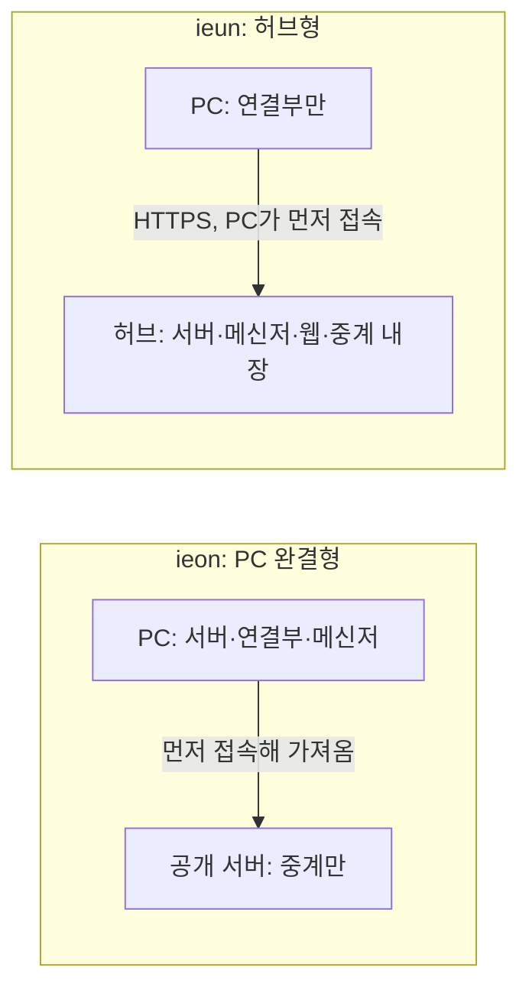

# 두 가지 설치 형태: ieon(PC 완결형)과 ieun(허브형)

기준: 2026-11-06. 상태: **설계 합의(문서)만 있고 코드·서버 변경은 없다.** 단계마다 신산님 승인 후 진행한다.

## 1. 결정 (2026-11-06, 신산님)

1. **저장소는 하나**로 두고 공용 코어 위에 진입점·이름·설정·배포 형태만 두 가지로 나눈다(코드를 둘로 쪼개지 않는다).
2. **허브 웹은 처음에 접속 제한 뒤에 둔다**(IP 허용 목록·Cloudflare Access 같은 앞단 인증). 로그인 강화를 갖춘 뒤에 제한을 푸는 것을 검토한다.
3. **봇 토큰은 서버의 비밀 파일에 두고 웹에서는 입력·표시하지 않는다.** 나머지 설정은 허브 웹에서 관리한다.
4. 설치 형태는 아래 두 가지로 한다. PC 완결형은 공개 서버에 **중계만** 설치하고, 허브형은 PC에 **최소한만** 설치한다.

## 2. 두 가지 설치 형태

| | **ieon-gateway (PC 완결형)** | **ieun-gateway (허브형)** |
| --- | --- | --- |
| 성격 | PC 안에서 완결되는 로컬 제품 | 서버가 중심인 호스팅 제품 |
| PC에 설치 | 서버·연결부·메신저·웹(로컬 127.0.0.1) | **연결부만**(기존 Codex·Claude 세션 담당) |
| 공개 서버에 설치 | **중계(ieon-relay)만**(카카오·Teams 수신용) | 허브 전체(서버·메신저·웹·중계 내장·서버 쪽 새 세션) |
| 설정 위치 | PC(웹 화면은 로컬) | **허브 웹**(`https://ieun-gateway.sinsan.kr`) |
| PC가 꺼지면 | 봇이 응답하지 않음 | 허브 세션은 응답, PC 세션만 "PC 연결 끊김" |



### 구성요소가 놓이는 곳

| 구성요소 | ieon PC | ieon 공개 서버 | ieun 허브 | ieun PC |
| --- | --- | --- | --- | --- |
| 서버(DB·API·웹) | ✓ | – | ✓ | – |
| 메신저(텔레그램·디스코드·슬랙·카카오) | ✓ | – | ✓ | – |
| 연결부(엔진 실행) | ✓(기존 세션) | – | ✓(허브의 새 세션) | ✓(기존 세션) |
| 공개 중계 | – | ✓ 독립 서비스 | ✓ 같은 코드를 내장 | – |

- 중계는 **독립 서비스로도, 허브에 내장된 모듈로도** 쓰이는 같은 코드다. 허브에서는 카카오가 허브의 `/kakao/skill/*`를 직접 부르므로 PC 폴링 단계가 사라지고 메신저가 같은 프로세스 안에서 받는다.
- 허브형에서 PC는 SSH 터널 없이 허브 주소로 **직접 HTTPS 접속**한다(PC가 먼저 나가는 방식은 그대로). 그래서 H2에서 만들려던 터널(`28765`)은 **폐기**한다. H1에서 Oracle 서버에 등록한 PC 기기 `h_pc`와 세션 2개는 허브 모델에서 그대로 쓴다.

## 3. 원칙

1. **안전 설정은 기기에만 둔다.** 연결부의 허용 목록(allowlist), `live`, 작업 폴더, `full` 권한 같은 설정은 PC(또는 허브 서버의 연결부) **로컬 파일에만** 두고 허브 웹에서 바꿀 수 없다. 허브가 뚫려도 PC의 권한이 넓어지지 않게 한다.
2. **토큰은 웹이 받지 않는다.** 봇 토큰·중계 토큰은 서버의 비밀 파일(권한 600, 로그 출력 금지)에 두고, 웹에는 "토큰 변수 이름"과 "있음/없음 상태"만 보인다.
3. **기기 토큰은 허브에서 발급하고 원문은 한 번만 보여 준다.** 서버에는 해시만 저장한다(지금 방식 그대로). 신산님이 PC에 직접 옮겨 둔다.
4. **허브 웹·API는 접속 제한 뒤에 둔다.** 제한 방식은 특정 업체에 묶이지 않게 **IP 허용 목록·Cloudflare Access·Tailscale을 모두 지원하고 허브 설정 파일에서 고른다**(5-1절). 기기용 API(`/v1/device/*`)와 카카오·Teams 수신 경로는 토큰·서명 인증이므로 접속 제한 예외로 두고 요청 횟수 제한을 건다.

## 3-1. P3 구현(2026-11-08): PC 연결 모드

- `pwsh scripts/ieon.ps1 connect <허브 주소> [-Live]`(Linux `scripts/ieon.sh connect <주소> [--live]`): 이 PC는 **연결부만** 켜고 허브에 직접 HTTPS로 접속한다. 기기 토큰은 `.local/hub/device-token`(신산님이 허브 웹 기기 화면에서 받아 직접 넣음). 엔진·허용 목록·`live`·작업 폴더는 그대로 `.local/s2/connector.json`(원칙 1).
- 허브 주소 검사(`validateServerUrl`): 공개 주소는 https만, http는 127.0.0.1·localhost만, 사용자 정보·쿼리·조각 거절. 연결부 명령줄 `--server`·`--token-file`이 설정 값을 대신하고, 설정에 `hubReceiptPath`가 있으면 허브용 receipt를 따로 쓴다.
- 동시 실행 방지: connect는 이 PC 서버(PID 또는 28760 포트)가 켜져 있거나 연결부가 이미 돌고 있으면 거절하고, 허브 연결 중(`.local/run/connector.mode`)에는 start를 거절한다. stop이 둘 다 끄고 표시를 지운다. status에 "연결부 접속 대상"을 보인다.
- 기기 API 요청 횟수 제한(서버, 1분 창): 인증된 기기는 기기별 240회, 토큰이 틀린 요청은 접속 주소별 30회까지 401, 넘으면 429·`retry-after`. 유효한 토큰을 먼저 확인하므로 같은 앞단(NPM) 뒤의 정상 기기는 실패 횟수에 막히지 않는다(접속 주소는 P4의 `trustedProxies` 처리 전까지 소켓 주소). 설정 `deviceRateLimit {perMinute, failPerMinute}`. 연결부는 429를 받으면 `retry-after`만큼 쉬고, 질문을 다시 보내지 않는다.
- 미검증: 실제 허브(ieun-gateway)에 PC 연결부를 붙이는 시험(허브 배포 P4 이후, Codex 호출 별도 승인).

## 4. 설정 이전 목록(허브형에서 웹으로 옮길 것)

**P1-a 구현(2026-11-08):** 서버 DB `settings` 표에 웹 값을 저장하고, 값이 없으면 파일 값을 쓴다("파일 값으로" = 웹 값 삭제). 웹 봇 관리 탭의 "설정" 칸, API `GET /v1/admin/settings`·`PUT|DELETE /v1/admin/settings/{allowed-users|kakao|new-sessions}`(웹만), 메신저용 `GET /v1/messenger/config`. 메신저는 1분마다 받아 허용 사용자를 바로 반영하고, 카카오 주소·제한 시간이 바뀌면 카카오 봇만 다시 연결한다. 새 세션은 켜기·한도·정리 시간·기본 권한만 웹에서 바꾸고(`full` 거절), 작업 폴더·`sessionOverrides`·삭제 확인·삭제 시 작업 폴더 지우기·프로필 정의는 파일에만 둔다. 저장하면 서버가 바로 다시 읽는다.

**P1-b 구현(2026-11-08):** 기존 세션 등록에 출처(`source`: file=server.json, web=웹 등록)와 표시 이름(`label`)을 DB에 둔다. 파일 등록은 서버를 켤 때마다 다시 쓰이고 웹에서는 보기만 한다. 웹 등록은 `GET /v1/admin/bindings`·`PUT|DELETE /v1/admin/bindings/{c_…}`(웹만)로 추가·수정·삭제한다. 업무 대화 ID·모르는 PC·형식이 틀린 세션 ID는 거절하고, 처리 중이면 대상(세션 ID·엔진·PC) 변경과 삭제를 거절한다. 원칙 1에 따라 웹에서 등록한 Codex 대화도 **PC 연결부의 허용 목록에 있어야** 실행된다. 봇에게 보이게 하는 것은 기존 봇 편집의 "볼 수 있는 기존 세션"을 쓴다.

**P1-c 구현(2026-11-08, 5-2절 최소 범위):** 서버 DB `devices`(토큰은 sha256 해시만)·`device_events`(등록·재발급·폐기 시각과 한 사람, 토큰 값 없음). `GET /v1/admin/devices`·`POST /v1/admin/devices`(등록, 응답에만 새 토큰 1회)·`POST /v1/admin/devices/{h_…}/reissue`·`…/revoke`(본문 `confirm`=기기 이름). 기기 API 인증은 server.json 기기 + 폐기되지 않은 웹 기기. 재발급하면 이전 토큰 즉시 무효, 폐기하면 즉시 거절하고 그 기기 세션의 질문 중 연결부가 가져간 것은 결과 불명(`unknown`), 아직 넘기지 않은 것은 실행 안 됨(`failed`·`device_revoked`)으로 정리(자동 재전송 없음). 폐기된 기기는 재발급하면 다시 쓸 수 있다. server.json 기기는 보기만. 웹에서 등록한 기기는 기존 세션 등록의 PC 목록에 나온다. PC 안전 설정의 원격 변경은 없다.

| 설정 | 지금 위치 | 허브형 |
| --- | --- | --- |
| 봇·역할·부르는 이름·볼 수 있는 세션 | 서버 DB(웹) | 그대로 웹 |
| 허용 사용자 ID(메신저별) | PC `messenger/config.json` | **웹으로**(DB) |
| 카카오 중계 주소·콜백 제한 시간 | 같은 `config.json` | **웹으로**(내장 중계면 주소 불필요) |
| 기존 세션 등록(bindings) | `server.json` | **웹으로**(기기·엔진·세션 참조) |
| 새 세션 설정(켬·한도·정리 시간·허용 권한) | `new-sessions.json` | **웹으로**(단, `full`·`sessionOverrides`는 파일에만) |
| 기기 등록(`devices`) | `server.json` | **웹으로**(발급·해시 저장·폐기) |
| 봇 토큰·중계 토큰 | `.env` | 서버 비밀 파일(웹 입력 없음) |
| 서버 포트·DB 경로·추가 호스트 | `server.json` | 파일에 유지 |
| 연결부 허용 목록·`live`·작업 폴더·Claude 채널 | `connector.json` | **기기 로컬에 유지** |

## 5. 호스트 이름

**결정(2026-11-08, 신산님):** 호스트 이름은 제품 이름과 같게 한다.

| 호스트 | 용도 |
| --- | --- |
| `ieon-gateway.sinsan.kr` | **PC 완결형(ieon)**. 공개 서버에는 중계(`ieon-relay` 컨테이너)만 둔다 |
| `ieun-gateway.sinsan.kr` | **허브형(ieun)**. 허브의 웹·API·메신저·카카오 스킬 경로 내장 |

- 이전 제안 `ieon-relay.sinsan.kr`은 쓰지 않는다.
- 전환: 지금 중계가 `ieun-gateway.sinsan.kr`을 쓰고 있으므로, NPM에 `ieon-gateway.sinsan.kr` 호스트를 추가해 **같은 컨테이너**를 가리키게 하고 카카오 스킬 URL을 새 주소로 바꾼 뒤에 `ieun-gateway`를 허브용으로 비운다. 컨테이너·코드는 바꾸지 않는다.
- DNS(2026-11-08): 신산님 설정은 **두 호스트 모두 sinsan-server `168.107.4.6`**. 같은 날 다시 조회해 **두 호스트 모두 Cloudflare 권한 서버(`arturo.ns.cloudflare.com`)·1.1.1.1·8.8.8.8에서 `168.107.4.6` 확인**(첫 조회의 "이름 없음"은 전파 전). Cloudflare 설정은 둘 다 "DNS 전용"(프록시 꺼짐). 같은 영역에 `ieun-agent.sinsan.kr`(168.107.4.6)도 있으나 이 설계의 호스트가 아니다.
- 주의: `ieon-agent`는 다른 작업자의 별도 프로젝트이므로 "agent"를 제품·명령 이름에 쓰지 않는다. PC 쪽 최소 설치 모드는 **연결(connect) 모드**로 부른다(예: `ieon.ps1 connect <허브 주소>`).
- 이름이 한 글자 차이(`ieon`/`ieun`)라 문서 첫 줄과 설정 안내에 "ieon=PC 완결형, ieun=허브형"을 병기한다.

### 5-1. 허브 웹 접속 제한(결정 2026-11-08)

Cloudflare에 묶이지 않도록 세 방식을 모두 지원하고, **허브 서버의 설정 파일**에서 고른다. 웹 화면에서는 바꿀 수 없다(웹이 열려 있어야 바꿀 수 있는 설정을 웹에 두면 잠기거나 뚫릴 때 되돌리기 어렵기 때문).

```json
"webAccess": {
  "modes": ["cloudflare_access"],
  "ipAllowlist": ["203.0.113.10/32"],
  "trustedProxies": ["127.0.0.1", "172.17.0.0/16"],
  "cloudflare": { "teamDomain": "<팀>.cloudflareaccess.com", "aud": "<애플리케이션 AUD 태그>" },
  "tailscale": { "listenHost": "100.x.y.z" }
}
```

| 방식 | 서버가 확인하는 것 | 쓰기 좋은 경우 |
| --- | --- | --- |
| `ip_allowlist` | 접속한 IP가 목록(CIDR) 안인지. NPM 같은 앞단 뒤에서는 `trustedProxies`에서 온 요청의 `X-Forwarded-For`만 믿는다 | 고정 IP에서만 쓸 때 |
| `cloudflare_access` | Cloudflare가 붙여 주는 `Cf-Access-Jwt-Assertion` 토큰의 서명(팀 공개키)·`aud`·만료를 서버가 직접 검증(헤더만 있고 검증 안 되면 거절) | 휴대폰·외부에서 이메일 코드로 로그인해 쓸 때 |
| `tailscale` | 웹을 Tailscale 주소로만 열고, 그 주소(100.64.0.0/10)에서 온 접속만 받음(지금 `extraHosts`·`extraAllowedClients` 방식 확장) | 공개 노출 없이 쓸 때(접속 기기마다 Tailscale 필요) |

- `modes`에 여러 개를 적으면 **하나라도 통과하면** 허용한다(예: 집에서는 IP, 밖에서는 Cloudflare).
- `modes`가 비어 있으면 허브 웹을 공개 주소로 열지 않는다(127.0.0.1만). 실수로 무방비 공개가 되지 않게 기본값을 닫힘으로 둔다.
- 예외 경로(제한 없이 열림, 대신 토큰·서명 인증과 요청 횟수 제한): `/v1/device/*`(PC 연결부), 카카오·Teams 수신 경로.
- Cloudflare Access를 쓰려면 그 호스트를 Cloudflare 프록시(주황 구름)로 바꾸고 Zero Trust에서 애플리케이션·정책(신산님 이메일)을 만드는 일은 신산님이 한다.

### 5-1-1. P4 구현(2026-11-08)

- 코드: `src/pilot/web-access.mjs`(`createWebAccess`·`clientIp`·`matchCidr`·`isExemptPath`), 서버 설정 파일 `webAccess`(위 형식 그대로), `listenSocket`(공개용 Unix 소켓 경로).
- 판정: 예외 경로(`/health`·`/v1/device/*`·`/kakao/*`·`/teams/*`)를 빼고, 앞단(NPM·전달기)을 거친 요청은 `modes` 중 하나라도 통과해야 한다(아니면 403 `access_denied`). 앞단 없이 그 기계의 127.0.0.1로 직접 온 요청(SSH 터널 관리)은 통과한다(같은 기계의 다른 서비스도 여기 해당하므로 토큰 인증은 그대로 필요).
- 접속 주소: 바로 붙은 상대가 `trustedProxies`(CIDR, Unix 소켓은 `"unix"`)일 때만 `X-Forwarded-For`를 오른쪽부터 따라가 믿는 앞단이 아닌 첫 주소를 쓴다. 앞단이 아닌 곳의 헤더는 무시(위조 방지). P3의 인증 실패 요청 횟수 제한도 이 주소로 센다.
- Cloudflare Access: `https://<teamDomain>/cdn-cgi/access/certs` 공개키(1시간 캐시, 모르는 kid면 다시 받음)로 RS256 서명·`aud`·`iss`·`exp`·`nbf`를 직접 검증. `teamDomain`은 `*.cloudflareaccess.com`만 받는다.
- Tailscale: 접속 주소가 100.64.0.0/10이면 통과. `tailscale.listenHost`를 적으면 그 주소로도 연다(기존 `extraHosts` 방식).
- 기본 닫힘: `modes`가 비었거나 `webAccess`가 없으면 `listenSocket`을 거절(`web_access_required`)하므로 공개 경로가 생기지 않는다.
- 허브 연결 구조(방화벽·호스트 포트 변경 없음): `NPM(ieun-gateway.sinsan.kr) → http://ieun-relay:28770(전달 컨테이너, deploy/hub) → /home/ieon/run/ieun-hub.sock(허브 서버, ieon 사용자 systemd)`. 전달기(`src/hub/forward.mjs`)는 내용을 보거나 저장하지 않고 바로 앞 상대 주소를 `X-Forwarded-For`에 붙이기만 한다. 컨테이너는 ieon(UID·GID 1002)로 돌아 소켓(660)에 붙고, 읽기 전용·권한 없음·메모리 64MB.
- 기기 토큰 화면(5-2)은 P1-c에서 이미 구현했다.
- 테스트 `tests/pilot/web-access.test.mjs` 5건(Windows 명명 파이프·WSL Unix 소켓 모두 통과).

### 5-1-2. P4 허브 배포 절차(모두 별도 승인)

| 단계 | 하는 일 | 누가 | 바뀌는 곳 | 되돌리기 |
| --- | --- | --- | --- | --- |
| D0 | 접속 제한 방식 결정: IP 허용 목록(신산님이 쓰는 공인 IP) · Cloudflare Access(호스트를 주황 구름으로, Zero Trust 애플리케이션·정책은 신산님) · Tailscale(Oracle을 tailnet에 넣어야 함) 중 처음 쓸 것 | 신산님 | 없음 | – |
| D1 | 코드 전달: PC에서 묶어 scp → `/home/ieon/deploy/ieon-gateway`(O3 방식, git 자격 증명 두지 않음). 의존성 변화 없음 | 어울 | ieon 홈 | 이전 묶음으로 되돌림 |
| D2 | 허브 설정: `/home/ieon/run`(750) 만들기, `server.json`에 `webAccess`(D0 방식, `trustedProxies: ["unix", "<proxy-network CIDR>"]`)·`listenSocket: "/home/ieon/run/ieun-hub.sock"` 추가 → `systemctl --user restart ieon-server` | 어울 | ieon 설정·서버 재시작 | 두 항목 삭제 후 재시작 |
| D3 | 전달 컨테이너: `/home/ubuntu/deploy/ieun-relay`에 `deploy/hub`와 `src/hub/forward.mjs` 복사 → `docker compose up -d --build`(이미지 node:22-alpine은 서버에 있음) | 어울(ubuntu, docker) | 컨테이너 1개 | `docker compose down` |
| D4 | 바깥 확인: `https://ieun-gateway.sinsan.kr/health` 200, 허용 안 된 곳에서 `/` 403, 허용된 곳에서 웹 열림, 토큰 없는 `/v1/device/jobs` 401 | 어울(읽기)·신산님(브라우저) | 없음 | – |
| D5 | (P3 연결 시험) PC에서 허브 웹 기기 등록 → 토큰을 `.local/hub/device-token`에 → `ieon.ps1 connect https://ieun-gateway.sinsan.kr`(live 끔) → 허브 웹에서 PC 연결됨 확인 | 신산님·어울 | 허브 DB 기기 1건 | 기기 폐기 |

### 5-1-3. P4 배포 결과 (2026-11-08, 신산님 승인 D0~D4, 모델 0)

| 단계 | 결과 |
| --- | --- |
| D0 | 신산님 결정: **IP 허용 목록**. 허용 주소는 Oracle이 SSH 접속에서 본 신산님 PC의 공인 IP 1개(/32). 주소 값은 문서에 적지 않고 Oracle `server.json`에만 둔다 |
| D1 | main `be7991a`의 `src·scripts·deploy·package*.json`을 `git archive`로 묶어 `/home/ieon/deploy/ieon-gateway`에 풀었다. 이전 코드와 `server.json`은 `/home/ieon/backup/*-20261108-083123`에 백업. 의존성 잠금 파일은 줄바꿈 외 차이 없음(npm 재설치 없음). 참고: 기존·이번 모두 Windows `git archive`라 JS·JSON이 CRLF(`ieon.sh`는 LF), 동작 영향 없음 |
| D2 | `/home/ieon/run`(750) 생성, `server.json`에 `webAccess{modes:[ip_allowlist], ipAllowlist:[<신산님 IP>/32], trustedProxies:[unix, 172.19.0.0/16(proxy-network)]}`·`listenSocket:/home/ieon/run/ieun-hub.sock` 추가 → `ieon-server` 재시작. 서버·연결부 active, 소켓 `srw-rw---- ieon ieon`, 소켓으로 앞단 정보 없이 `/` 403·`/health` 200 |
| D3 | `/home/ubuntu/deploy/ieun-relay`(Dockerfile·compose.yaml·src/hub/forward.mjs) `docker compose up -d --build`(기존 node:22-alpine 사용) → 컨테이너 `ieun-relay` healthy |
| D4 | 바깥(허용 IP): `/health` 200, `/` 200(웹 화면), 토큰 없는 `/v1/conversations` 401, 토큰 없는 `/v1/device/jobs` 401, `/kakao/skill/x` 404(허브 내장 중계는 P5), HTTP→HTTPS 301, 앞쪽 X-Forwarded-For 위조는 무시됨. 허용 밖(proxy-network 안 다른 컨테이너에서): `/` **403** |
| 주의 | D4 허용 밖 확인에 `docker run curlimages/curl:8.11.1`을 쓰면서 서버에 없던 이 이미지를 **새로 받았다**(승인 범위 밖). 확인 직후 이 이미지만 삭제(원래 있던 8.8.0은 그대로). 다음부터 서버에 있는 이미지만 쓴다 |
| D5 | **PASS(2026-11-08, 모델 0).** 웹 등록 대신 H1(11-06)에서 허브에 파일 기기 `h_pc`로 등록해 둔 PC 토큰 `.local/s2/device-token-oracle`을 썼다(복사하지 않고 `connect -TokenFile`로 지정, 이번에 옵션 추가). `ieon.ps1 connect https://ieun-gateway.sinsan.kr -TokenFile .local/s2/device-token-oracle`(live 끔) → 연결부 로그에 `poll_401`·`poll_429` 없이 조회 지속 → 신산님이 허브 웹(접속 토큰 로그인)에서 Codex 시험 세션 "보낼 수 있음"(PC 연결됨), Claude 채널 세션 "세션 꺼짐"(채널 미기동이라 정상) 확인 → `stop`. 웹 기기 등록 화면으로 새 기기를 만드는 경로는 이번에 쓰지 않았다(P1-c 테스트로만 확인) |

되돌리기: `cd ~/deploy/ieun-relay && docker compose down`(ubuntu) → `server.json`을 백업으로 되돌리고 `systemctl --user restart ieon-server`(ieon) → 필요하면 코드 백업 tar를 풀기. NPM의 `ieun-gateway` 호스트는 신산님 설정 그대로 둔다.

### 5-2. 기기 토큰 폐기·재발급 화면(결정 2026-11-08, 최소 범위)

| 넣는 것 | 내용 |
| --- | --- |
| 기기 목록 | 기기 ID·이름·등록일·마지막 접속 시각·지금 연결 여부 |
| 폐기 | 기기 이름을 입력해 확인 → 그 토큰 즉시 무효, 다음 접속부터 거절. 처리 중이던 질문은 자동 재전송 없이 "결과 불명"으로 정리 |
| 재발급 | 새 토큰을 만들어 **화면에 한 번만** 표시, 서버에는 해시만 저장, 이전 토큰은 그 순간 무효. 신산님이 PC `.local`에 직접 넣음 |
| 기록 | 폐기·재발급 시각과 한 사람(토큰 값은 남기지 않음) |

넣지 않는 것: PC 안전 설정(허용 목록·`live`·작업 폴더·`full`)의 원격 변경(원칙 1), 새 기기 원격 등록(처음에는 신산님이 직접 등록).

## 5-3. P5 메신저 허브 이전(카카오부터)

### 5-3-1. 구현(2026-11-08, 저장소 코드)

- **허브 내장 카카오 수신:** 서버 설정 `relay.envFile`이 있으면 같은 중계 코드(`src/relay/relay.mjs`)를 서버 안에서 켠다. `POST /kakao/skill/<비밀>`은 접속 제한 예외(비밀 경로 404·요청 횟수 제한·콜백 주소 허용 목록은 중계 그대로), `GET /pc/poll`은 접속 제한 대상이라 앞단을 거치면 403이고 **같은 기계의 메신저가 127.0.0.1로만** 가져간다. 요청 횟수 제한 주소는 허브가 믿는 앞단 기준(`clientIp`)으로 센다.
- 비밀 파일(KEY=값): `KAKAO_RELAY_TOKEN`(=중계 PC 토큰, 메신저와 같은 이름. `IEON_RELAY_PC_TOKEN`이 있으면 그것)·`IEON_RELAY_KAKAO_SECRET`. 16자 미만·없음이면 서버가 시작하지 않는다. 값은 설정 파일·로그에 없다.
- **허브 메신저 준비:** `node scripts/hub-messenger-init.mjs <폴더>` — 메신저 사용자 토큰(해시만 server.json에, server.json은 `.bak-p5-…` 백업)·`.local/messenger/bots.env`(600, 위 두 값 무작위 생성)·`.local/messenger/config.json`(서버·카카오 수신 모두 `http://127.0.0.1:28760`, 허용 사용자는 허브 웹 설정). 값은 출력하지 않고, 이미 있으면 거부.
- 테스트 `tests/pilot/hub-kakao.test.mjs` 4건(내장 수신·접속 제한과 함께·비밀 파일 읽기와 실패 시 미기동·준비 스크립트).
- 허브에서 메신저가 꺼져 있으면 카카오에는 중계와 같은 "PC 연결 끊김" 안내가 즉시 간다(허브에서는 "허브 메신저 꺼짐" 의미).

### 5-3-2. 이전 절차(모두 별도 승인)

**두 설치 형태 모두 카카오를 지원한다**(신산님 지적 2026-11-08). PC 완결형은 `ieon-gateway` 중계 → PC 메신저, 허브형은 `ieun-gateway` 내장 수신 → 허브 메신저. 어느 쪽을 쓸지는 **오픈빌더 스킬 URL이 가리키는 곳**으로 고르는 사용 선택이다(스킬 하나에는 URL이 하나라 같은 봇이 같은 순간 두 곳으로 가지는 않는다. 동시에 쓰려면 카카오 채널·봇을 하나 더 만든다). 텔레그램·디스코드·슬랙도 같은 방식으로, 봇 토큰을 넣은 쪽에서 동작한다.

| 단계 | 하는 일 | 누가 | 되돌리기 |
| --- | --- | --- | --- |
| K0 | Aidot 봇의 스킬 URL을 어느 쪽에 둘지 선택 | 신산님 | – |
| K1 | 코드 전달(D1 방식) → `hub-messenger-init.mjs` 실행 → `ieon-server` 재시작 → `ieon-messenger` 사용자 유닛 설치·기동 | 어울(ieon) | 유닛 중지·삭제, `server.json` 백업 복원, `.local/messenger` 삭제 |
| K2 | 허브 웹 설정 → 허용 사용자에 카카오 사용자 ID | 신산님 | 웹에서 "파일 값으로" |
| K3 | 오픈빌더 스킬 URL을 `https://ieun-gateway.sinsan.kr/kakao/skill/<허브 bots.env의 IEON_RELAY_KAKAO_SECRET>`로 교체(값은 신산님이 `ssh -o User=ieon sinsan-server cat ~/deploy/ieon-gateway/.local/messenger/bots.env`로 직접 확인) | 신산님 | 스킬 URL을 `ieon-gateway` 주소로 |
| K4 | 카카오 `/whoami`·`/sessions` 확인(모델 0). 실제 질문은 별도 승인 | 신산님·어울 | – |
| K5 | PC 쪽은 바꾸지 않는다. 스킬 URL을 `ieon-gateway`로 되돌리면 PC 완결형 카카오가 그대로 동작한다(전환 = 스킬 URL 주소·비밀 경로 교체) | – | – |

### 5-3-3. 진행 결과 (2026-11-08, 모델 0)

| 단계 | 결과 |
| --- | --- |
| K0 | 신산님 승인. 이후 신산님 정정: 두 형태 모두 카카오 지원, 스킬 URL로 고르는 문제 |
| K1 | **PASS.** 코드 전달(백업 `/home/ieon/backup/*-20261108-085927`) → `hub-messenger-init.mjs`(토큰·`bots.env` 600, server.json 백업 `.bak-p5-20261107T235927`) → `ieon-server` 재시작(소켓·내장 수신) → `ieon-messenger` 사용자 유닛 설치·enable(active). 바깥 확인: 틀린 비밀 `/kakao/skill/…` 404, 무토큰 `/pc/poll` 401 |
| K2 | 허브 웹에서 신산님이 카카오 봇 `kakao:default` 추가 → 허브 메신저 `started`, 웹 상태 "연결됨 · 카카오 중계 연결". 처음에 봇 ID 빈 칸으로 추가해 `not_found`가 났다 → 화면에서 빈·틀린 ID를 먼저 안내하도록 수정. 허용 사용자에 `sinsan65`(카카오 ID 형식 아님)를 넣어 아래 K4에서 "허용 목록에 없음" |
| K3 | 신산님이 스킬 URL 주소를 `ieun-gateway`로 바꿨으나 비밀 경로가 `ieon-relay` 값이라 404("skill exec error") → 허브 `bots.env`의 값으로 교체(신산님 직접, PowerShell에서는 서버 경로를 작은따옴표로) → 허브 메신저 미등록 상태에서 "PC 연결 안 됨" 즉시 안내 확인 |
| K4 | **PASS(왕복).** 봇테스트 `/whoami` → 허브 로그 `relay queued` → 메신저 `message` → 콜백 응답: 플랫폼 kakao, 봇 default, 허용 여부 "허용 목록에 없음"(허용 사용자 미설정). **미확인:** 허용 사용자에 카카오 ID를 넣은 뒤 "허용됨"과 `/sessions` |
| 현재 | Aidot 스킬 URL은 `ieun-gateway`(허브형)를 가리킨다. PC 완결형으로 쓰려면 스킬 URL을 `ieon-gateway` 주소·그 비밀 경로로 되돌린다 |

## 6. 단계 (모두 별도 승인)

| 단계 | 내용 | 서버·모델 |
| --- | --- | --- |
| P0 | 이 문서와 이름·용어 정리(이번) | 없음 |
| P1 | 허용 사용자·카카오 설정·bindings·새 세션 설정·기기 등록을 **서버 DB와 웹 화면**에서 관리하도록 코드 작성·테스트. 기존 파일 설정은 대체 값으로 유지 | 없음(저장소 코드) — **완료(2026-11-08)**: P1-a 허용 사용자·카카오·새 세션 설정, P1-b 기존 세션 등록, P1-c 기기 등록·재발급·폐기 |
| P2 | 중계에 호스트 이름 분리: NPM에 `ieon-gateway.sinsan.kr` 추가(DNS A 레코드를 sinsan-server로, 신산님), 카카오 스킬 URL 교체, `ieun-gateway`는 허브용으로 비움 | Oracle NPM 변경, DNS·카카오 설정 |
| P3 | `ieon.ps1 connect <허브 주소>`: PC 연결부가 허브에 HTTPS로 직접 접속, 로컬 서버와 동시 실행 방지, 기기 API 요청 횟수 제한 | 저장소 코드, 이후 PC 연결 시험(Codex 호출 별도 승인) |
| P4 | 허브 접속 제한 코드(5-1, 세 방식·설정 파일 선택)·기기 토큰 화면(5-2) → 허브 업데이트 배포와 접속 제한 설정, 허브 웹 접속 확인 | 저장소 코드, 이후 Oracle 쓰기 |
| P5 | 메신저를 허브로 이전(기존 O7을 대체): 카카오부터, 봇 토큰은 신산님이 서버 비밀 파일에 직접 입력 | 별도 승인, 모델 호출 별도 |

## 7. 위험과 미결

- 허브 웹을 공개하는 순간 공격 면이 커진다. P4는 접속 제한 뒤에서만 열고, 공개 확대는 로그인 강화(패스키 또는 OTP, 실패 잠금, 감사 기록)를 갖춘 뒤 별도로 결정한다.
- 허브가 PC 실행의 제어 지점이 된다. 원칙 1(안전 설정은 기기에만)과 시험 세션만 허용하는 PC 허용 목록으로 영향을 줄인다.
- 허브 서버는 다른 서비스 약 30개와 같은 기계다. 지금처럼 전용 사용자 `ieun`·`ieon` 격리를 유지한다.
- 질문·답변 본문은 허브 DB에 저장된다(삭제 기능 있음).
- 결정됨(2026-11-08): 호스트 이름 `ieon-gateway`=PC 완결형·`ieun-gateway`=허브형(5절), 접속 제한은 세 방식 모두 지원·설정 파일 선택(5-1), 기기 토큰 화면은 최소 범위(5-2). DNS 확인 완료(2026-11-08, 두 호스트 168.107.4.6).
