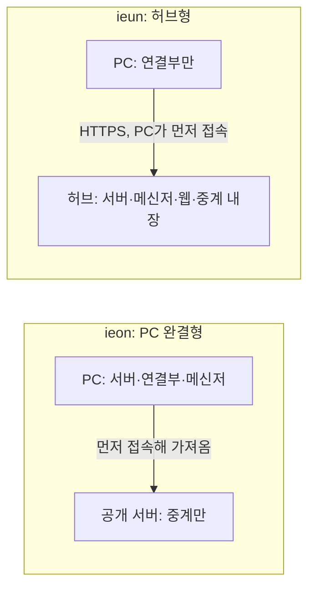

# 두 가지 설치 형태: ieon(PC 완결형)과 ieun(허브형)

기준: 2026-11-06. 상태: **설계 합의(문서)만 있고 코드·서버 변경은 없다.** 단계마다 신산님 승인 후 진행한다.

## 1. 결정 (2026-11-06, 신산님)

1. **저장소는 하나**로 두고 공용 코어 위에 진입점·이름·설정·배포 형태만 두 가지로 나눈다(코드를 둘로 쪼개지 않는다).
2. **허브 웹은 처음에 접속 제한 뒤에 둔다**(IP 허용 목록·Cloudflare Access 같은 앞단 인증). 로그인 강화를 갖춘 뒤에 제한을 푸는 것을 검토한다.
3. **봇 토큰은 서버의 비밀 파일에 두고 웹에서는 입력·표시하지 않는다.** 나머지 설정은 허브 웹에서 관리한다.
4. 설치 형태는 아래 두 가지로 한다. PC 완결형은 공개 서버에 **중계만** 설치하고, 허브형은 PC에 **최소한만** 설치한다.

## 2. 두 가지 설치 형태

| | **ieon-gateway (PC 완결형)** | **ieun-gateway (허브형)** |
| --- | --- | --- |
| 성격 | PC 안에서 완결되는 로컬 제품 | 서버가 중심인 호스팅 제품 |
| PC에 설치 | 서버·연결부·메신저·웹(로컬 127.0.0.1) | **연결부만**(기존 Codex·Claude 세션 담당) |
| 공개 서버에 설치 | **중계(ieon-relay)만**(카카오·Teams 수신용) | 허브 전체(서버·메신저·웹·중계 내장·서버 쪽 새 세션) |
| 설정 위치 | PC(웹 화면은 로컬) | **허브 웹**(`https://ieun-gateway.sinsan.kr`) |
| PC가 꺼지면 | 봇이 응답하지 않음 | 허브 세션은 응답, PC 세션만 "PC 연결 끊김" |

### 구성요소가 놓이는 곳

| 구성요소 | ieon PC | ieon 공개 서버 | ieun 허브 | ieun PC |
| --- | --- | --- | --- | --- |
| 서버(DB·API·웹) | ✓ | – | ✓ | – |
| 메신저(텔레그램·디스코드·슬랙·카카오) | ✓ | – | ✓ | – |
| 연결부(엔진 실행) | ✓(기존 세션) | – | ✓(허브의 새 세션) | ✓(기존 세션) |
| 공개 중계 | – | ✓ 독립 서비스 | ✓ 같은 코드를 내장 | – |

- 중계는 **독립 서비스로도, 허브에 내장된 모듈로도** 쓰이는 같은 코드다. 허브에서는 카카오가 허브의 `/kakao/skill/*`를 직접 부르므로 PC 폴링 단계가 사라지고 메신저가 같은 프로세스 안에서 받는다.
- 허브형에서 PC는 SSH 터널 없이 허브 주소로 **직접 HTTPS 접속**한다(PC가 먼저 나가는 방식은 그대로). 그래서 H2에서 만들려던 터널(`28765`)은 **폐기**한다. H1에서 Oracle 서버에 등록한 PC 기기 `h_pc`와 세션 2개는 허브 모델에서 그대로 쓴다.

## 3. 원칙

1. **안전 설정은 기기에만 둔다.** 연결부의 허용 목록(allowlist), `live`, 작업 폴더, `full` 권한 같은 설정은 PC(또는 허브 서버의 연결부) **로컬 파일에만** 두고 허브 웹에서 바꿀 수 없다. 허브가 뚫려도 PC의 권한이 넓어지지 않게 한다.
2. **토큰은 웹이 받지 않는다.** 봇 토큰·중계 토큰은 서버의 비밀 파일(권한 600, 로그 출력 금지)에 두고, 웹에는 "토큰 변수 이름"과 "있음/없음 상태"만 보인다.
3. **기기 토큰은 허브에서 발급하고 원문은 한 번만 보여 준다.** 서버에는 해시만 저장한다(지금 방식 그대로). 신산님이 PC에 직접 옮겨 둔다.
4. **허브 웹·API는 앞단 접속 제한 뒤에 둔다.** 기기용 API(`/v1/device/*`)는 토큰 인증이므로 따로 공개 경로로 열 수 있게 하되 요청 횟수 제한을 건다.

## 4. 설정 이전 목록(허브형에서 웹으로 옮길 것)

| 설정 | 지금 위치 | 허브형 |
| --- | --- | --- |
| 봇·역할·부르는 이름·볼 수 있는 세션 | 서버 DB(웹) | 그대로 웹 |
| 허용 사용자 ID(메신저별) | PC `messenger/config.json` | **웹으로**(DB) |
| 카카오 중계 주소·콜백 제한 시간 | 같은 `config.json` | **웹으로**(내장 중계면 주소 불필요) |
| 기존 세션 등록(bindings) | `server.json` | **웹으로**(기기·엔진·세션 참조) |
| 새 세션 설정(켬·한도·정리 시간·허용 권한) | `new-sessions.json` | **웹으로**(단, `full`·`sessionOverrides`는 파일에만) |
| 기기 등록(`devices`) | `server.json` | **웹으로**(발급·해시 저장·폐기) |
| 봇 토큰·중계 토큰 | `.env` | 서버 비밀 파일(웹 입력 없음) |
| 서버 포트·DB 경로·추가 호스트 | `server.json` | 파일에 유지 |
| 연결부 허용 목록·`live`·작업 폴더·Claude 채널 | `connector.json` | **기기 로컬에 유지** |

## 5. 호스트 이름

- 허브: `ieun-gateway.sinsan.kr`(웹·API·카카오 스킬 경로 내장).
- PC 완결형용 중계: **`ieon-relay.sinsan.kr`**(제안, 신산님이 DNS A 레코드 추가). 제품 이름과 맞춰 PC 완결형(ieon)은 `ieon-relay`, 허브형(ieun)은 `ieun-gateway`로 갈린다.
- 전환: 지금 중계가 `ieun-gateway.sinsan.kr`을 쓰고 있으므로, NPM에 `ieon-relay.sinsan.kr` 호스트를 추가해 **같은 컨테이너**를 가리키게 하고 카카오 스킬 URL을 새 주소로 바꾼 뒤에 `ieun-gateway`를 허브용으로 비운다. 컨테이너·코드는 바꾸지 않는다.
- 주의: `ieon-agent`는 다른 작업자의 별도 프로젝트이므로 "agent"를 제품·명령 이름에 쓰지 않는다. PC 쪽 최소 설치 모드는 **연결(connect) 모드**로 부른다(예: `ieon.ps1 connect <허브 주소>`).
- 이름이 한 글자 차이(`ieon`/`ieun`)라 문서 첫 줄과 설정 안내에 "ieon=PC 완결형, ieun=허브형"을 병기한다.

## 6. 단계 (모두 별도 승인)

| 단계 | 내용 | 서버·모델 |
| --- | --- | --- |
| P0 | 이 문서와 이름·용어 정리(이번) | 없음 |
| P1 | 허용 사용자·카카오 설정·bindings·새 세션 설정·기기 등록을 **서버 DB와 웹 화면**에서 관리하도록 코드 작성·테스트. 기존 파일 설정은 대체 값으로 유지 | 없음(저장소 코드) |
| P2 | 중계에 호스트 이름 분리: NPM에 `ieon-relay.sinsan.kr` 추가(DNS는 신산님), 카카오 스킬 URL 교체 | Oracle NPM 변경, 카카오 설정 |
| P3 | `ieon.ps1 connect <허브 주소>`: PC 연결부가 허브에 HTTPS로 직접 접속, 로컬 서버와 동시 실행 방지, 기기 API 요청 횟수 제한 | 저장소 코드, 이후 PC 연결 시험(Codex 호출 별도 승인) |
| P4 | 허브 업데이트 배포와 앞단 접속 제한 설정, 허브 웹 접속 확인 | Oracle 쓰기 |
| P5 | 메신저를 허브로 이전(기존 O7을 대체): 카카오부터, 봇 토큰은 신산님이 서버 비밀 파일에 직접 입력 | 별도 승인, 모델 호출 별도 |

## 7. 위험과 미결

- 허브 웹을 공개하는 순간 공격 면이 커진다. P4는 접속 제한 뒤에서만 열고, 공개 확대는 로그인 강화(패스키 또는 OTP, 실패 잠금, 감사 기록)를 갖춘 뒤 별도로 결정한다.
- 허브가 PC 실행의 제어 지점이 된다. 원칙 1(안전 설정은 기기에만)과 시험 세션만 허용하는 PC 허용 목록으로 영향을 줄인다.
- 허브 서버는 다른 서비스 약 30개와 같은 기계다. 지금처럼 전용 사용자 `ieun`·`ieon` 격리를 유지한다.
- 질문·답변 본문은 허브 DB에 저장된다(삭제 기능 있음).
- 미결: `ieon-relay.sinsan.kr` 사용 여부(신산님이 DNS 작업), 접속 제한 방식(IP 허용 목록 또는 Cloudflare Access), 기기 토큰 폐기·재발급 화면 범위.
